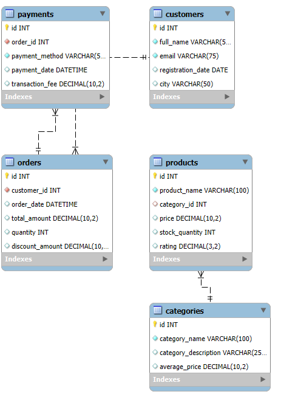

# E-Commerce Sales & Customer Analytics

## Project Overview
This project focuses on analyzing an e-commerce business using **MySQL**. It explores customer behavior, sales performance, product categories, inventory levels, and payment methods to derive meaningful business insights.

The project uses a relational database containing five interconnected tables and applies SQL queries to perform data validation and business analysis.

## Tools & Technologies
- MySQL
- MySQL Workbench
- SQL

## Database Structure

The database consists of five tables:

| Table | Description |
|---|---|
| categories | Stores product category information |
| products | Stores product details, prices, stock and ratings |
| customers | Stores customer information |
| orders | Stores order details, amounts and discounts |
| payments | Stores payment methods and transaction fees |

### Entity Relationship Diagram



## Project Tasks & Analysis

### 1. Data Cleaning & Validation
- Checked missing values across all tables.
- Handled blank customer city values.
- Validated primary key and foreign key relationships.
- Identified suspicious discount records.

### 2. Customer Analysis
- Identified the top 5 cities by customer count.
- Analyzed the top 10 customers by total spending.
- Identified customers with the highest number of orders.
- Found registered customers who never placed an order.
- Compared revenue generated by different cities.

### 3. Sales & Order Analysis
- Calculated total revenue, average order value (AOV), and order count.
- Analyzed monthly revenue trends.
- Identified the 10 highest-value orders.
- Calculated total discounts and discount percentage.
- Compared monthly revenue to identify declining sales.

### 4. Product & Category Analysis
- Compared average product prices across categories.
- Identified the highest-rated products.
- Analyzed low-stock products.
- Compared product counts across categories.
- Ranked the top 3 highest-priced products within each category.

### 5. Payment & Business Insights
- Analyzed payment method usage.
- Compared average transaction fees across payment methods.
- Identified orders with suspicious discount amounts.
- Calculated individual customer revenue contribution.

## SQL Concepts Used
- SELECT, WHERE, ORDER BY, LIMIT
- Aggregate Functions: COUNT(), SUM(), AVG()
- GROUP BY and HAVING
- INNER JOIN and LEFT JOIN
- Common Table Expressions (CTEs)
- CASE WHEN
- Subqueries
- Window Functions
- ROW_NUMBER() and LAG()
- Data Validation and Referential Integrity

## Key Findings
The analysis was designed to identify:
- High-value customers and important customer locations.
- Monthly sales trends and declining revenue periods.
- Product categories with higher average prices.
- Inventory items requiring attention.
- Payment method preferences.
- Potentially inconsistent discount records.

## Dataset Information
The project uses a structured e-commerce dataset containing five CSV files:
- categories.csv
- products.csv
- customers.csv
- orders.csv
- payments.csv

## Project Limitations
- The database does not contain an order-items table linking individual orders to products.
- Therefore, product-wise sales revenue and best-selling products by sales quantity cannot be accurately calculated.
- The low-stock threshold of 250 units is an assumed benchmark used for inventory analysis.
- Discount amounts greater than order amounts are flagged for investigation rather than automatically treated as invalid records.

## Repository Structure

```text
ecommerce-sales-customer-analytics/
│
├── README.md
│
├── SQL/
│   └── ecommerce_project.sql
│
└── ER_Diagram/
    └── ecommerce_ER_diagram.png
```

## Conclusion
This project demonstrates practical SQL skills through relational database design, data validation, customer analytics, sales trend analysis, inventory analysis, and business-focused queries.

It provides hands-on experience in using MySQL to explore structured business data and derive actionable insights.
